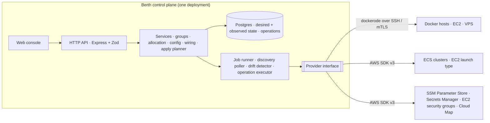
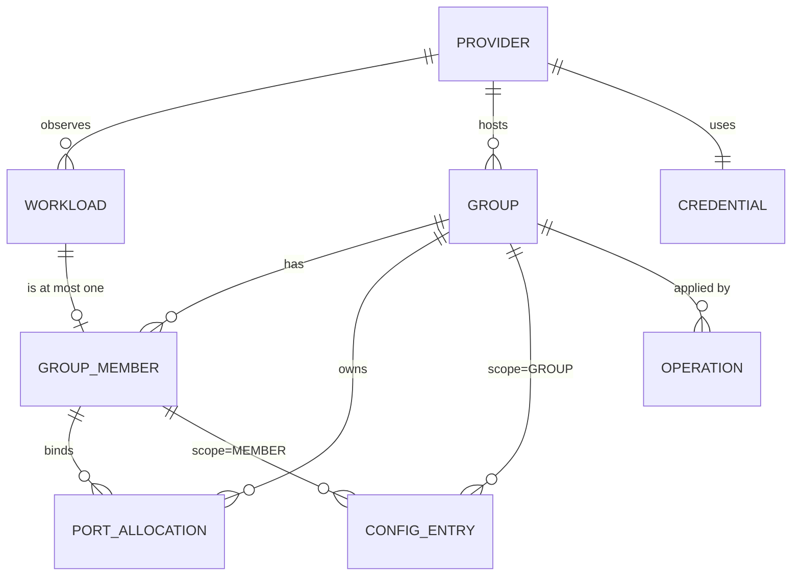
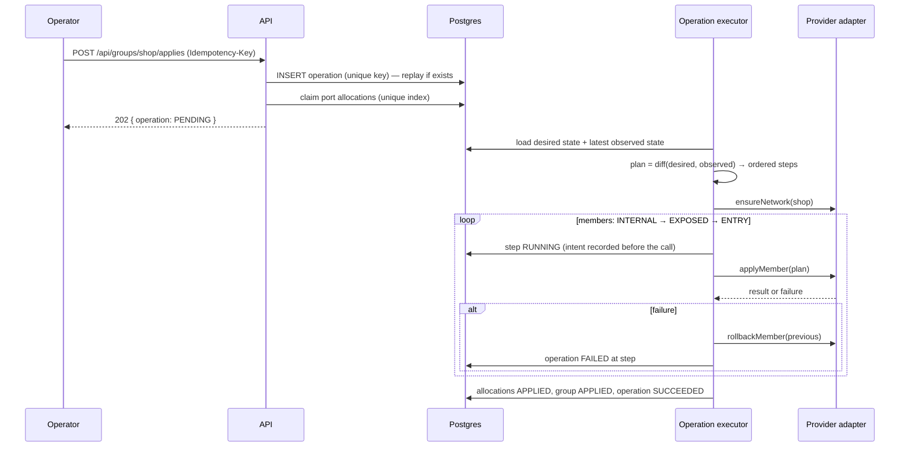

# Berth — Design and Architecture

Status: **Accepted**, v0.2 (2026-10-21). Decisions applied: ECS EC2 launch type with bridge networking; control plane hosted as a Replit deployment. Pairs with `SPEC.md` (what and why), `CAPABILITY-MAP.md` (modules and build order), and `docs/decisions/` (the reasoning behind each choice below).

## 1. System overview

Berth is a single control-plane service with a web console, backed by Postgres. It holds **desired state** (groups, port allocations, config, wiring) and continuously observes **actual state** on two kinds of runtime through two adapters behind one interface. It never installs an agent on your hosts: Docker hosts are reached outbound over SSH (or mutual TLS), ECS through the AWS SDK.

<!-- diagram: topology -->


Design rules that fall out of this shape:

- **Read before write, by construction.** Modules `providers`, `discovery`, `groups`, `config`, and `integration` only read from runtimes or write to Postgres. Only `apply` mutates a runtime, and it does so through a logged, idempotent `Operation`.
- **One model, two runtimes.** The core never sees a Docker container or an ECS task; it sees a `Workload`. Runtime differences are absorbed by the adapters and declared through `ProviderCapabilities` so the UI can grey out what a runtime cannot do (for example choosing a host port on Fargate).
- **Desired state is the source of truth, observed state is evidence.** A group is "applied" when the planner finds no diff between the two. Anything else is `DRIFTED`, which is a state to show, not an error to hide.

## 2. Domain model



| Entity | Key fields | Notes |
|---|---|---|
| `Provider` | `kind: DOCKER_HOST \| ECS_CLUSTER`, `name`, `status: ONLINE \| OFFLINE \| DEGRADED`, `lastSeenAt`, `capabilities`, kind-specific `settings` | Docker: `transport: SSH \| TCP_TLS`, `host`, `port`, `sshUser`. ECS: `region`, `clusterArn`, `vpcId`, `launchTypes`. Credentials live in `Credential`, encrypted. |
| `Workload` | `providerId`, `externalId` (container id / task ARN), `name`, `image`, `status: RUNNING \| STOPPED \| MISSING \| UNKNOWN`, `ports[]`, `networks[]`, `labels`, `envHash`, `observedAt` | Observed only. `envHash` is a hash of the environment as seen on the runtime, used for drift; values are never stored. |
| `Group` | `providerId`, `name` (slug), `entryPort`, `protocol`, `status: DRAFT \| APPLYING \| APPLIED \| DRIFTED \| FAILED`, `networkRef` | One provider per group. `networkRef` is the Docker network name or the Cloud Map namespace id. |
| `GroupMember` | `groupId`, `workloadId`, `serviceName` (DNS-safe), `role: ENTRY \| INTERNAL \| EXPOSED`, `containerPort`, `healthCheck?` | Exactly one `ENTRY` per group. `serviceName` is what other members use to reach it. |
| `PortAllocation` | `providerId`, `hostPort`, `protocol`, `groupId`, `memberId`, `state: RESERVED \| APPLIED \| RELEASED` | Partial unique index on `(providerId, hostPort, protocol) WHERE state <> 'RELEASED'`. This index *is* the collision guard. |
| `ConfigEntry` | `scopeType: GROUP \| MEMBER`, `scopeId`, `key`, `isSecret`, `source: MANUAL \| AWS_SSM \| AWS_SECRETS_MANAGER`, `valueCiphertext?`, `sourceRef?` | Member entries override group entries with the same key. `sourceRef` is an SSM parameter name or a Secrets Manager ARN. |
| `Operation` | `groupId`, `kind: APPLY \| ROLLBACK \| RELEASE`, `idempotencyKey`, `requestHash`, `state: PENDING \| RUNNING \| SUCCEEDED \| FAILED \| UNKNOWN`, `steps[]`, `error?` | Unique on `(groupId, idempotencyKey)`. `steps[]` is the executed plan with per-step status, so a crash mid-apply leaves evidence of what to resolve. |
| `Credential` | `kind: SSH_KEY \| TLS_BUNDLE \| AWS_KEYS \| AWS_ROLE`, `ciphertext`, `keyVersion` | AES-256-GCM, envelope key from `BERTH_MASTER_KEY`. Decrypted only inside the adapter that needs it. |

## 3. The Provider interface (the contract between core and runtimes)

Defined first; both adapters and the in-memory fake implement it. Core code depends only on this.

```ts
export interface Provider {
  readonly kind: "DOCKER_HOST" | "ECS_CLUSTER";
  capabilities(): ProviderCapabilities;
  checkConnectivity(): Promise<ConnectivityReport>;

  // discovery (read-only)
  listWorkloads(): Promise<ObservedWorkload[]>;
  inspectWorkload(externalId: string): Promise<ObservedWorkloadDetail>;
  watch?(onEvent: (e: WorkloadEvent) => void): Promise<Unsubscribe>; // Docker events; ECS polls

  // mutation (apply only)
  ensureNetwork(group: GroupRef): Promise<NetworkRef>;
  applyMember(plan: MemberPlan): Promise<MemberResult>;   // recreate container / register task def + update service
  rollbackMember(plan: MemberPlan, previous: MemberResult): Promise<void>;
  releaseNetwork(ref: NetworkRef): Promise<void>;

  // secrets (read-only)
  resolveSecretRef?(ref: SecretRef): Promise<string>;      // SSM / Secrets Manager, used for Docker hosts only
}

export interface ProviderCapabilities {
  canChooseHostPort: boolean;        // Docker: true. ECS EC2 launch type, bridge mode: true. awsvpc task definitions (and Fargate): false
  canRecreateInPlace: boolean;       // Docker: true. ECS: false (new task-definition revision + service update)
  supportsNativeSecrets: boolean;    // ECS: true (secrets[] with ARNs). Docker: false (values injected at apply)
  supportsEvents: boolean;           // Docker events stream: true. ECS: false
  serviceDiscovery: "DOCKER_DNS" | "SERVICE_CONNECT";
}
```

Runtime mapping

| Concern | Docker host adapter | ECS adapter |
|---|---|---|
| Workload | container | task, grouped under its service |
| Transport | `dockerode` over `ssh2` tunnel or TCP + mutual TLS | AWS SDK v3, credentials via IAM keys or `AssumeRole` |
| Group network | user-defined bridge `berth-<group>`; members attached with alias `serviceName` | ECS Service Connect with a Cloud Map HTTP namespace `berth-<group>`; `discoveryName = serviceName` |
| Port change | recreate container with new `HostConfig.PortBindings` | new task-definition revision with `portMappings.hostPort` from Berth's allocation (bridge mode); `awsvpc`: validate `hostPort == containerPort` |
| Env change | recreate container with merged `Env` | new revision: plain values in `environment`, refs in `secrets[].valueFrom` |
| Entry port ingress | the host port binding itself | `AuthorizeSecurityGroupIngress` on the container instance security group (bridge) or the task security group (`awsvpc`) |
| Health after apply | member `healthCheck` (TCP/HTTP probe through the SSH tunnel) or container `Health` | `waitUntilServicesStable` + deployment circuit breaker |
| Drift signal | events + 30 s poll | 30 s poll of `DescribeServices` / `DescribeTasks` |

## 4. Port model

You give a group one number: its **entry port**. Everything else is derived.

| Member role | Host port | Who reaches it |
|---|---|---|
| `ENTRY` (exactly one) | the group's entry port | the outside world |
| `INTERNAL` (default) | none | other members, by `serviceName` on the group network |
| `EXPOSED` | allocated from the host's range (default `20000–29999`) | the outside world, on a port Berth chose and recorded |

Allocation rules

1. A claim is a single `INSERT` into `port_allocations`; the partial unique index decides collisions. There is no check-then-insert.
2. Before claiming, the allocator also consults observed state: host ports already bound by **unmanaged** containers on that host are treated as taken, so Berth never fights a container it does not own. These are advisory (they can change under us); the unique index is the guarantee among Berth's own groups.
3. On ECS with the EC2 launch type and bridge networking (the operator's setup), the allocator works exactly as on Docker hosts; the per-host range applies per container instance. For `awsvpc` task definitions `canChooseHostPort` is false: the entry port must equal the entry member's container port, and the allocator validates and records instead of choosing.
4. Allocations move `RESERVED → APPLIED` when the operation succeeds and `→ RELEASED` when a member leaves or the group is deleted. Released rows are kept for audit; the partial index ignores them.
5. Changing the entry port is an apply like any other: claim the new port first, recreate the entry member, release the old port last. A failed apply releases the new claim.

## 5. Config and secrets

- Two scopes, one merge rule: `MEMBER` overrides `GROUP` by key. Injected `SVC_*` variables are added last and cannot be overridden (they are the wiring, not config).
- `MANUAL` values are encrypted with AES-256-GCM under a per-row data key wrapped by `BERTH_MASTER_KEY`. Key rotation re-wraps data keys; it does not re-encrypt values.
- `AWS_SSM` and `AWS_SECRETS_MANAGER` entries store only the reference. On ECS the reference is passed through natively in `secrets[]`, so the plaintext never transits Berth. On Docker hosts there is no native equivalent: the adapter resolves the reference at apply time and injects the value into the container's environment. This is a known trade-off, documented as a gotcha in the UI: anyone with `docker inspect` on that host can read it.
- Responses never carry secret values. A config entry reads as `{ key, isSecret: true, valuePresent: true, source, sourceRef?, updatedAt }`.
- Redaction is enforced at the logger (`pino` redact paths plus a value-based scrubber seeded with the current secret set), not at call sites.

Injected variables, for member `api` in group `shop` with members `web` (3000), `api` (4000), `db` (5432):

```
BERTH_GROUP=shop
BERTH_SELF=api
BERTH_SELF_PORT=4000
SVC_WEB_HOST=web      SVC_WEB_PORT=3000   SVC_WEB_URL=http://web:3000
SVC_DB_HOST=db        SVC_DB_PORT=5432    SVC_DB_URL=tcp://db:5432
```

`HOST` is the member's `serviceName`, resolvable on the group network by Docker DNS or Service Connect. The prefix and URL scheme per member are configurable at the group level; changing them after first apply is an "ask first" boundary because consumers will depend on them.

## 6. Apply: from desired state to runtime operations

<!-- diagram: apply -->


Planner rules

- The plan is a pure function of `(desired, observed, capabilities)` and is unit-tested as such. Steps are `ENSURE_NETWORK`, `APPLY_MEMBER`, `OPEN_INGRESS`, `RELEASE_PORT`, `RELEASE_NETWORK`.
- Members are applied `INTERNAL → EXPOSED → ENTRY` so dependencies are up before the public face moves. Each member is one step; a step is retried at most twice on transport errors and never on provider-reported validation errors.
- **Docker recreate** (the adapter's `applyMember`): inspect → create `name.berth-next` with the same image, command, mounts, restart policy, and labels, plus new `Env`, `PortBindings`, and network attachment → stop old → rename old to `name.berth-prev` → rename new to `name` → start → health probe → remove prev. On failure: stop new, rename and start prev, remove new. Anonymous volumes are flagged in the UI before apply because recreate cannot carry them.
- **ECS apply**: describe service and task definition → register a new revision with updated `portMappings` (host ports from allocations in bridge mode), `environment`, `secrets`, Service Connect configuration → `UpdateService` → `waitUntilServicesStable` (bounded). ECS's own deployment circuit breaker performs the rollback; Berth records the outcome. In bridge mode a rolling deployment briefly needs the old and new task on the same instance, so the host port is reserved for the new task only after the old one drains; Berth uses `minimumHealthyPercent = 0` / `maximumPercent = 100` for single-instance services and documents this as a gotcha.
- Every call has three outcomes, not two. A timeout leaves the step and the operation in `UNKNOWN`; the next discovery pass reconciles it to `SUCCEEDED` or `FAILED` from observed state. Berth never auto-retries an `UNKNOWN` mutation.

## 7. Discovery and drift

- Docker: on connect, `listContainers({ all: true })`; then subscribe to the events stream (`start`, `die`, `destroy`, `rename`, `network connect/disconnect`) with a 30 s full poll as the safety net.
- ECS: a 30 s poll per cluster: `ListServices → DescribeServices → ListTasks → DescribeTasks`, with task-definition descriptions cached by ARN.
- Each pass upserts `Workload` rows and marks anything not seen for two passes as `MISSING`.
- Drift detector: for each `APPLIED` group, compare observed ports, network membership, and `envHash` with desired; any difference sets the group to `DRIFTED` with a per-member reason. Drift is shown, not auto-corrected; "Re-apply" is one click and one operation.

## 8. HTTP API contract

Conventions (from `api-and-interface-design`): plural nouns, no verbs; `camelCase` fields and query params; `UPPER_SNAKE` enums; one error shape; every list paginated; additive changes only. Zod schemas in `shared/contracts` are the contract; the OpenAPI document is generated from them.

| Method and path | Purpose | Notes |
|---|---|---|
| `GET /api/providers` · `POST /api/providers` | list, register | `POST` runs a connectivity check and returns `201` with `status` |
| `GET /api/providers/:id` · `PATCH` · `DELETE` | read, update settings, remove | `DELETE` is `409 PROVIDER_HAS_GROUPS` while groups exist |
| `POST /api/providers/:id/connectivity-checks` | re-test credentials | returns the `ConnectivityReport` |
| `GET /api/workloads?providerId=&status=&page=&pageSize=` | inventory | observed state; read-only |
| `GET /api/workloads/:id` | detail | ports, networks, labels, `envHash`, group membership |
| `GET /api/groups` · `POST /api/groups` | list, create | `POST` validates entry port availability and returns `201` in `DRAFT` |
| `GET /api/groups/:id` · `PATCH` · `DELETE` | read, update entry port or settings, delete | `DELETE` releases ports and schedules network release |
| `POST /api/groups/:id/members` · `PATCH /api/groups/:id/members/:memberId` · `DELETE` | manage membership and roles | a second `ENTRY` is `422 ENTRY_ALREADY_SET` |
| `GET /api/groups/:id/ports` | allocations | current `RESERVED` and `APPLIED` rows |
| `GET /api/groups/:id/config` · `PATCH /api/groups/:id/config` | group-scope entries | `PATCH` body is a partial map; `null` deletes a key |
| `GET /api/groups/:id/members/:memberId/config` · `PATCH` | member-scope entries | same shape; values masked on read |
| `GET /api/groups/:id/plan` | dry run | the steps an apply would execute now |
| `POST /api/groups/:id/applies` | apply | requires `Idempotency-Key`; `202` with the operation; replay returns `200` and the original |
| `GET /api/operations?groupId=&page=&pageSize=` · `GET /api/operations/:id` | history, status | steps with timestamps and redacted errors |

Error shape and status mapping

```json
{ "error": { "code": "PORT_IN_USE", "message": "Port 8080/TCP is already allocated on this host", "details": { "groupId": "grp_…" } } }
```

`400` malformed · `401` not authenticated · `404` not found · `409` conflict (`PORT_IN_USE`, `OPERATION_IN_PROGRESS`, `PROVIDER_HAS_GROUPS`) · `422` validation (`VALIDATION_ERROR`, `ENTRY_ALREADY_SET`, `IDEMPOTENCY_KEY_REUSED`, `CAPABILITY_NOT_SUPPORTED`) · `502` provider error (`PROVIDER_UNREACHABLE`, `PROVIDER_REJECTED`, message sanitised) · `500` internal, no details.

Pagination: `{ "data": [...], "pagination": { "page": 1, "pageSize": 50, "totalItems": 142, "totalPages": 3 } }`, default `pageSize` 50, max 200.

Idempotency on `applies`: the key is claimed by the unique index on `(groupId, idempotencyKey)` in the same transaction that records the operation. Same key + same `requestHash` replays the stored response. Same key + different body is `422 IDEMPOTENCY_KEY_REUSED`. A second apply while one is `RUNNING` is `409 OPERATION_IN_PROGRESS`. Keys are retained for 30 days, longer than any retry path Berth has.

## 9. Security

- Secrets at rest: AES-256-GCM, data keys wrapped by `BERTH_MASTER_KEY` (32 bytes, provided as a deployment secret, never in the repo).
- Docker transport: SSH with a dedicated key pair generated by Berth and shown once for `authorized_keys`, or mutual TLS with a client certificate. Plain `tcp://` is rejected at validation.
- AWS: least-privilege policy shipped in `docs/aws-policy.json` — `ecs:List*`, `ecs:Describe*`, `ecs:RegisterTaskDefinition`, `ecs:UpdateService`, `ec2:DescribeSecurityGroups`, `ec2:AuthorizeSecurityGroupIngress`, `ec2:RevokeSecurityGroupIngress`, `servicediscovery:*Namespace*` and `*Service*`, `ssm:GetParameter(s)`, `secretsmanager:GetSecretValue`, `iam:PassRole` scoped to task roles, `sts:GetCallerIdentity`.
- Auth: single admin account, Argon2id password hash, HTTP-only session cookie, CSRF token on mutations. OIDC is a v2 candidate.
- Audit: every `Operation` and every config change records who, when, and the diff (keys only for secrets).
- Third-party responses (Docker API, AWS) are parsed through Zod before use; unexpected shapes become `PROVIDER_REJECTED`, never a crash or a trust decision.

## 10. Failure modes and how they are handled

| Failure | Behaviour |
|---|---|
| Host unreachable during discovery | provider `DEGRADED`, workloads keep last observation with stale marker; no mutation attempted |
| Recreate succeeds but health probe fails | rollback to previous container; operation `FAILED` at that step; group `FAILED` with reason |
| Crash between "step RUNNING" and provider response | step `UNKNOWN` on restart; discovery reconciles; operator sees exactly which member to inspect |
| Port taken by an unmanaged container between claim and apply | provider rejects the binding; step fails; claim released; `409 PORT_IN_USE` surfaced with the offending container |
| `awsvpc` service with entry port ≠ container port | rejected at `PATCH /groups/:id` with `422 CAPABILITY_NOT_SUPPORTED` before any apply |
| Secret reference cannot be resolved (deleted parameter) | apply fails at plan time (dry run) for Docker hosts; ECS surfaces it as a task start failure, recorded from service events |

## 11. Risks and mitigations

- **Downtime per recreate.** Each Docker member restarts once per apply (seconds). Mitigation: order `INTERNAL → EXPOSED → ENTRY`, apply only members whose desired state changed, show the plan before running it. Blue/green on Docker hosts is a v2 candidate.
- **Secrets visible via `docker inspect` on Docker hosts.** Inherent to Docker environment injection; mitigated by documenting it and by preferring ECS native secrets where available. A file-mount delivery mode is a v2 candidate.
- **SSH transport stability.** One pooled connection per host with keepalive and exponential backoff; discovery degrades gracefully, apply refuses to start on a `DEGRADED` provider.
- **Hyrum's Law on `SVC_*`.** Once apps read these names they are a contract; they are versioned by group setting (`injectionVersion: 1`) and never changed in place.
